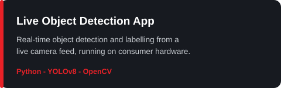
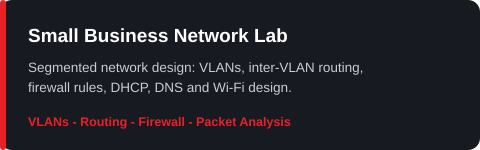
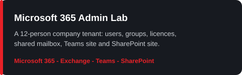

<p align="center">
  
</p>

<h1 align="center">Hi, I'm Neel Patel</h1>

<p align="center">
  
</p>

<p align="center">
  
  
</p>

---

## My Support Protocol

```text
when a ticket lands, I work it the same way every time:

  1. LISTEN      hear the user out, in plain words
  2. REPRODUCE   see the problem myself before touching anything
  3. DIAGNOSE    simple cause first: cables, settings, logs
  4. FIX         smallest change that solves it, then test it
  5. DOCUMENT    write it down so the next fix is faster
  6. FOLLOW UP   check back later: is it still working?
```

That is how I run every lab I build, and how I will run every ticket I get.

## About Me

I learn by building. Computer Systems Technician & Networking diploma from Cambrian College, a Diploma in Computer Applications, and Cisco cybersecurity certifications, backed by hands-on home labs, not just coursework.

- 🔭 I'm currently building IT support home labs: Active Directory, networking, and Microsoft 365
- 🌱 I'm currently learning CompTIA A+ and SQL for data analysis
- 💬 Ask me about IT support, Active Directory, Windows Server, networking, and Microsoft 365
- 💼 Background: supervising busy teams and first-contact customer service in high-volume environments
- 🎯 Goal: my first IT support role, open to opportunities across Canada
- 📫 Reach me at neelp9478@gmail.com
- 📍 Sudbury, Ontario, Canada

## My Perfect Stack

<p align="center">
  
</p>
<p align="center">
  
</p>

**Systems & support:** Windows 10/11 · Windows Server 2022 · Active Directory · Group Policy · Microsoft 365 · Microsoft Office · Desktop Support · IT Support & Troubleshooting · End-User Support · User Account Management · Computer Hardware · Customer Service

**Networking:** TCP/IP · DNS · DHCP · VLANs · VPN · Cisco · Packet Tracer

**Tools & platforms:** PowerShell · VMware · VirtualBox · Linux · Ticketing Systems (osTicket)

**Data & development:** SQL · Database Management (DBMS) · Data Structures · Python · YOLOv8 · OpenCV · HTML/CSS · Web Design · Tally ERP with GST

## Signals

<p align="center">
  
</p>

## Projects

| | |
|---|---|
|  |  |
|  |  |

## GitHub Stats

<p align="center">
  
  
  
</p>

<p align="center">
  <picture>
    <source media="(prefers-color-scheme: dark)" srcset="https://raw.githubusercontent.com/NpOS17/NpOS17/output/github-contribution-grid-snake-dark.svg" />
    
  </picture>
</p>

## Building Next

- **Finishing the IT Support Lab in VirtualBox:** Server01 domain controller plus a Windows 11 client joining the domain, osTicket ticketing, and backup and recovery.
- **SQL to data analysis track:** currently working through JOINs, building toward Power BI dashboards.
- **Service desk simulator practice:** ticket handling, triage, and documentation drills.

## Education & Certifications

- Computer Systems Technician & Networking diploma, Cambrian College (2024)
- Diploma in Computer Applications, Baroda Institute of Technology (2022)
- Cisco Junior Cybersecurity Analyst Career Path · Cisco Introduction to Cybersecurity
- CompTIA A+ (in progress)

## Connect With Me

<p align="center">
  <a href="https://www.linkedin.com/in/neel-patel-it"></a>
  <a href="https://www.instagram.com/__.neelpatel.__/"></a>
  <a href="https://muse.ai/s/neel-patel-portfolio-tomas-style-xzxx6m5xtl3huxh/44rs8uC9gN1nl-HjxoLSA9T-gfn27ZKRX8RhxAimXuw"></a>
  <a href="mailto:neelp9478@gmail.com"></a>
</p>
